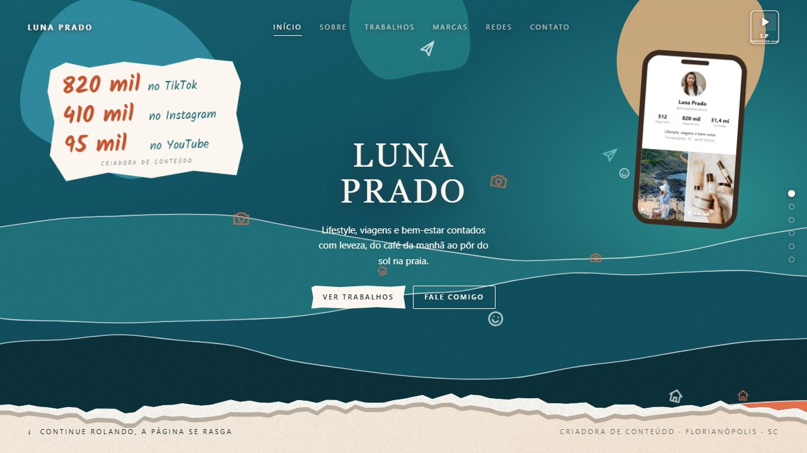

# Site de media kit com páginas que se rasgam

Media kit online para criadores de conteúdo: uma página única em que cada capítulo (capa, sobre, trabalhos, marcas, redes e contato) se abre rasgando o anterior conforme a pessoa rola.

**Demonstração:** https://site-midiakit-rasgando-template.davi-santiago-6-68d.workers.dev



O botão redondo ao lado do nome, no topo, troca o tema do site: **Neon** (padrão), **Mar**, **Pôr do sol** e **Azul**. Cada tema muda cores, fundos, fontes e os ícones que flutuam, sem mexer nos textos. Também dá para abrir direto num tema pelo endereço, por exemplo `?tema=neon`.

O perfil da demonstração (Luna Prado) é fictício: nome, números, campanhas e marcas foram inventados. Em produção, o mesmo código atende vários influenciadores reais, cada um com o próprio site e domínio.

## O que o projeto resolve

Influenciadores costumam mandar o media kit em PDF para as marcas. Este projeto troca o PDF por um site leve, que abre bem no celular, toca os vídeos das campanhas e gera uma prévia bonita quando o link é colado no WhatsApp. Um cliente novo entra criando uma pasta com os dados dele, sem mexer no componente.

## Destaques técnicos

- **Um build por cliente.** Cada influenciador fica em `clients/<nome>/` com `config.ts`, `site.json` e `public/`. O `vite.config.ts` liga só aquele cliente ao build (alias `@client` e `publicDir` próprio), então os dados e arquivos de um nunca vão parar no site de outro.
- **Temas sem tocar no componente.** Os temas ficam em `clients/demo/themes.ts`. O `App` aplica o tema escolhido por props e um botão separado (`src/components/ui/theme-switcher`) entra no menu do topo por portal, ao lado do nome. A escolha fica guardada no navegador.
- **Tudo configurável por props.** O componente `CreatorPortfolio` recebe textos, números, paleta, fundos, fontes e ícones. Novos recursos entram como props opcionais, para não alterar os sites que já estão no ar.
- **Prévia de link e busca resolvidas no build.** Um plugin do Vite grava no HTML o título, a descrição, as tags Open Graph, dados estruturados em JSON-LD (`ProfilePage` e `Person`), `canonical` e um resumo em `<noscript>`, e gera `robots.txt` e `sitemap.xml`. Isso importa porque o WhatsApp e alguns buscadores não executam JavaScript.
- **Animação feita à mão.** Os rasgos são caminhos SVG gerados com sementes, para cada borda ser irregular e sempre igual entre visitas. A rolagem controla a abertura de cada capítulo, com encaixe no computador.
- **Navegação pensada para o celular.** Em telas de toque, o deslize e os botões de subir e descer passam um capítulo por vez, sem rolagem solta no meio de um rasgo.
- **Vídeos que respeitam o navegador.** O vídeo da campanha toca com som só quando o capítulo de trabalhos está na tela. Se o navegador bloquear o som, ele começa mudo e liga no primeiro toque.
- **Acessibilidade.** Respeita `prefers-reduced-motion`, tem rótulos para leitores de tela e navegação por teclado nos pontos de audiência.
- **Sem servidor.** O resultado é um site estático publicado em Cloudflare Workers. Nos sites de clientes, cada push na `main` dispara o build e a publicação.

## Stack

React 18, TypeScript, Vite 6, Tailwind CSS 4 e Motion. Publicação em Cloudflare Workers (arquivos estáticos).

## Como rodar

Requer Node.js 20 ou mais novo.

```bash
npm install
npm run dev
```

O site abre em http://localhost:5173 com o cliente de demonstração.

```bash
npm run typecheck
npm run build -- --mode demo
```

O build sai em `dist/demo/`. Sem `--mode`, o build falha de propósito, para não publicar o cliente errado.

## Como criar um cliente

1. Copie `clients/demo/` para `clients/<nome>/`.
2. Troque textos, números, links e paleta no `config.ts`, e coloque fotos e vídeos em `public/`. Os caminhos no `config.ts` começam em `/`.
3. Preencha o `site.json` com título, descrição, endereço final e imagem de prévia (1200×630). Os campos `person`, `summary`, `brands` e `keywords` são opcionais e alimentam os dados para buscadores.
4. Rode `npm run dev -- --mode <nome>` para ver e `npm run build -- --mode <nome>` para gerar.

## Publicar na Cloudflare

```bash
npm run build -- --mode demo
npx wrangler deploy --name site-midiakit-rasgando-template --assets=dist/demo --compatibility-date=2026-11-01
```

Para publicar a cada push, ligue o repositório ao Worker em Workers Builds, com `npm run build -- --mode <nome>` como comando de build e `npx wrangler deploy --assets=dist/<nome> --compatibility-date=2026-11-01` como comando de deploy.

## Estrutura

```
clients/demo/        dados, textos e imagens do perfil de demonstração
clients/demo/themes.ts   os quatro temas (cores, fundos, fontes e ícones)
src/components/ui/theme-switcher/      o botão de troca de tema
src/components/ui/creator-portfolio/   o componente do media kit
src/App.tsx          carrega o cliente escolhido no build
vite.config.ts       escolha do cliente, prévia de link e dados para buscadores
```

## Créditos

- A ideia visual dos cartões-postais rasgados parte de um template compartilhado na comunidade 21st.dev, usado com autorização do autor e reescrito para o caso de media kit.
- Fotos da demonstração: [Pexels](https://www.pexels.com), de uso livre.
- Fontes dos temas: Kalam, Montserrat e Bricolage Grotesque, todas com licença livre (OFL).
- Desenvolvido por [Davi Santiago](https://github.com/DaviSantii).
